# 🏃 世界必跑絕景馬拉松 LLM Wiki 總首頁與知識地圖
> **World's Scenic & Iconic Marathons Knowledge Vault**  
> 彙整全球 12 場殿堂級馬拉松、4 大跨賽事主題索引樞紐、四季跑旅時程與深度攻略的 Obsidian 知識庫。

---

## 🧭 知識庫架構與全景導航（Knowledge Architecture）

本 Wiki 採用「**核心首頁 (MOC) ➔ 四大主題樞紐 (Hubs) ➔ 十二場深度賽事 (Leaves)**」的三層中心輻射網狀架構，所有筆記均透過 Obsidian 雙向連結（`[[賽事名稱]]`）與 YAML Frontmatter 屬性無縫串聯：

```mermaid
flowchart TD
    HOME(["🏠 00_世界必跑絕景馬拉松_首頁索引"]):::homeClass
    
    H1["🏛️ 世界馬拉松大滿貫與經典城市賽道"]:::hubClass
    H2["⛰️ 極限地形與山岳沙漠挑戰"]:::hubClass
    H3["🌿 世界遺產與自然荒野賽道"]:::hubClass
    H4["📅 全球四季跑旅日曆"]:::hubClass

    HOME ==> H1
    HOME ==> H2
    HOME ==> H3
    HOME ==> H4

    %% Hub 1 Races
    H1 --> R_TYO["🇯🇵 日本東京馬拉松"]:::raceClass
    H1 --> R_LON["🇬🇧 倫敦馬拉松"]:::raceClass
    H1 --> R_BER["🇩🇪 德國柏林馬拉松"]:::raceClass
    H1 --> R_ROM["🇮🇹 羅馬馬拉松"]:::raceClass

    %% Hub 2 Races
    H2 --> R_JNG["🇨🇭 少女峰馬拉松"]:::raceClass
    H2 --> R_PTR["🇯🇴 約旦佩特沙漠馬拉松"]:::raceClass
    H2 --> R_BSU["🇺🇸 美國大瑟爾國際馬拉松"]:::raceClass
    H2 -.-> R_B5["🇿🇦 南非五大野生動物馬拉松"]:::raceClass

    %% Hub 3 Races
    H3 --> R_ANG["🇰🇭 吳哥窟王朝馬拉松"]:::raceClass
    H3 --> R_ATH["🇬🇷 雅典經典馬拉松"]:::raceClass
    H3 --> R_B5
    H3 --> R_QTN["🇳🇿 紐西蘭皇后鎮馬拉松"]:::raceClass
    H3 --> R_FUJ["🇯🇵 日本富士山"]:::raceClass

    %% Hub 4 connects all
    H4 -.-> R_TYO & R_ROM & R_LON & R_BSU & R_B5 & R_ANG & R_JNG & R_PTR & R_BER & R_ATH & R_QTN & R_FUJ

    classDef homeClass fill:#1e293b,stroke:#38bdf8,stroke-width:3px,color:#fff;
    classDef hubClass fill:#0f766e,stroke:#2dd4bf,stroke-width:2px,color:#fff;
    classDef raceClass fill:#1e1b4b,stroke:#818cf8,stroke-width:1.5px,color:#fff;
```



---

## 📚 四大跨賽事主題索引樞紐（Topic Hubs）

| 主題樞紐 | 聚焦領域與核心價值 | 涵蓋代表賽事 | 核心閱讀價值 |
| :--- | :--- | :--- | :--- |
| **[[世界馬拉松大滿貫與經典城市賽道]]** | 都會競速、平坦賽道、世界紀錄、慈善募款與抽籤攻略 | [[日本東京馬拉松]]、[[倫敦馬拉松]]、[[德國柏林馬拉松]]、[[羅馬馬拉松]] | 掌握 WMM 大滿貫與歐洲古都賽道特性、抽籤與免抽資格（BQ）時間軸、完賽率與 PB 潛力剖析。 |
| **[[極限地形與山岳沙漠挑戰]]** | 高山垂直爬升、荒漠軟沙戈壁、海岸懸崖強逆風與野外險坡 | [[少女峰馬拉松]]、[[約旦佩特沙漠馬拉松]]、[[美國大瑟爾國際馬拉松]]、[[南非五大野生動物馬拉松]] | 破解溫根壁、颶風角、蛇道沙地等魔王路段，掌握混合路面越野跑鞋選型、防砂套裝備與配速修正公式。 |
| **[[世界遺產與自然荒野賽道]]** | 聯合國世界文化遺產（UNESCO）、千年古文明神廟、野生動物生態保護區 | [[吳哥窟王朝馬拉松]]、[[雅典經典馬拉松]]、[[南非五大野生動物馬拉松]]、[[紐西蘭皇后鎮馬拉松]]、[[日本富士山]] | 體驗在無圍欄非洲草原直面五霸巨獸、吳哥叢林僧侶祈福、雅典大理石競技場衝線與無痕跑旅（LNT）法則。 |
| **[[全球四季跑旅日曆]]** | 1 至 12 月年度賽程時序、跨國跑旅倒數規劃（Timeline） | 全球 12 場賽事按月份完整編排 | 一站式年度海外跑旅規劃手冊，涵蓋 T-12 月抽籤到 T-1 週長途越洋飛行抗水腫的完整前置工作流程。 |

---

## 🏆 十二場世界必跑絕景馬拉松總覽矩陣（Master Matrix）

| 賽事名稱 | 舉辦月份 | 國家 / 城市 | 地貌與地形特徵 | 難度評級 | 必跑絕景亮點與文化意義 | 主題歸屬 |
| :--- | :---: | :--- | :--- | :---: | :--- | :--- |
| **[[日本東京馬拉松]]** | **3月** | 🇯🇵 日本・東京 | 極平坦寬闊都會公路 | 初級 | 雙重賽道設計、文化巡禮與都市衝刺、沿途日式私補盛宴與高達 96% 完賽率 | [[世界馬拉松大滿貫與經典城市賽道]] |
| **[[羅馬馬拉松]]** | **3月** | 🇮🇹 義大利・羅馬 | 平坦公路穿插 6km 鵝卵石路面 | 中等 | 競技場起終點，穿越聖天使城堡與梵蒂岡，沉浸於兩千年流動的露天博物館 | [[世界馬拉松大滿貫與經典城市賽道]]<br>[[世界遺產與自然荒野賽道]] |
| **[[倫敦馬拉松]]** | **4月** | 🇬🇧 英國・倫敦 | 泰晤士河沿岸平緩微起伏 | 初級 | 格林威治起跑、登上倫敦塔橋、白金漢宮馬爾大道衝線，全球規模最大慈善嘉年華 | [[世界馬拉松大滿貫與經典城市賽道]] |
| **[[美國大瑟爾國際馬拉松]]** | **4月** | 🇺🇸 美國・加州 | 太平洋懸崖丘陵公路（起伏大） | 高 | 加州一號公路絕景、波濤洶湧太平洋海浪、長達 2 英里「颶風角」長陡坡與強勁海風 | [[極限地形與山岳沙漠挑戰]]<br>[[世界遺產與自然荒野賽道]] |
| **[[南非五大野生動物馬拉松]]** | **6月** | 🇿🇦 南非・恩塔貝尼 | 原始草原紅土、43度陡坡與軟沙 | 極高 | 毫無人工圍欄隔絕直面「非洲五霸」巨獸，武裝巡邏員戒護，顛覆路跑定義的荒野冒險 | [[極限地形與山岳沙漠挑戰]]<br>[[世界遺產與自然荒野賽道]] |
| **[[吳哥窟王朝馬拉松]]** | **8月** | 🇰🇭 柬埔寨・暹粒 | 平坦公路與林蔭古蹟泥石路 | 中高 | 黎明微曦穿越小吳哥與巴戎寺微笑佛陀，熱帶雨林林蔭道，人道關懷與心靈洗禮之跑 | [[世界遺產與自然荒野賽道]] |
| **[[少女峰馬拉松]]** | **9月** | 🇨🇭 瑞士・因特拉肯 | 湖岸平路轉高山越野（爬升 1,953m） | 極高 | 艾格峰、僧侶峰與少女峰萬年冰河伴跑，惡名昭彰「溫根壁」與海拔 2,320m 終點 | [[極限地形與山岳沙漠挑戰]]<br>[[世界遺產與自然荒野賽道]] |
| **[[約旦佩特沙漠馬拉松]]** | **9月** | 🇯🇴 約旦・佩特拉 | 砂岩峽谷蛇道、深層紅沙與戈壁山脊 | 極高 | 清晨包場獨享世界遺產玫瑰紅古城卡茲尼神殿，翻越極端乾燥高溫的中東紅砂沙漠 | [[極限地形與山岳沙漠挑戰]]<br>[[世界遺產與自然荒野賽道]] |
| **[[德國柏林馬拉松]]** | **9月** | 🇩🇪 德國・柏林 | 全球最平坦寬闊之柏油路面 | 初級 | 人類馬拉松極限與破紀錄搖籃，秋高氣爽競速環境，衝過布蘭登堡門的高光時刻 | [[世界馬拉松大滿貫與經典城市賽道]] |
| **[[雅典經典馬拉松]]** | **11月** | 🇬🇷 希臘・雅典 | 公路賽道含長達 21km 連續爬升 | 高 | 追尋菲迪皮德斯 2,500 年史詩足跡，自馬拉松鎮奔向全大理石建造之帕那辛奈克體育場 | [[世界遺產與自然荒野賽道]]<br>[[極限地形與山岳沙漠挑戰]] |
| **[[紐西蘭皇后鎮馬拉松]]** | **11月** | 🇳🇿 紐西蘭・皇后鎮 | 鋪裝公路結合硬質碎石湖畔步道 | 中等 | 地球上最美麗的馬拉松，穿梭淘金小鎮箭鎮、海耶斯湖與卓越山脈倒影的中土絕景 | [[世界遺產與自然荒野賽道]] |
| **[[日本富士山]]** | **11月** | 🇯🇵 日本・河口湖 | 湖畔環湖公路（含 21km 激坂坡） | 中等 | 深秋火紅楓葉迴廊，雙湖環抱聖山富士山，清晨「逆富士」湖面倒影與兩日跑步嘉年華 | [[世界遺產與自然荒野賽道]] |

---

## 🎯 多維度跑者決策導航（Quick Filters）

### 1. 依參賽目標與訴求分類
- ⚡ **破個人最佳成績（PB Seekers）**：[[德國柏林馬拉松]] ➔ [[日本東京馬拉松]] ➔ [[倫敦馬拉松]]
- 🏛️ **古典歷史與文明朝聖（History & Culture）**：[[雅典經典馬拉松]] ➔ [[羅馬馬拉松]] ➔ [[吳哥窟王朝馬拉松]] ➔ [[約旦佩特沙漠馬拉松]]
- 🏔️ **壯麗自然與湖光山色（Scenic Nature）**：[[少女峰馬拉松]] ➔ [[日本富士山]] ➔ [[紐西蘭皇后鎮馬拉松]] ➔ [[美國大瑟爾國際馬拉松]]
- 🦁 **野生生態與極限荒野（Wild Adventure）**：[[南非五大野生動物馬拉松]] ➔ [[約旦佩特沙漠馬拉松]] ➔ [[少女峰馬拉松]]

### 2. 依賽道地形挑戰難度分級
- 🟢 **初級難度（都會平路、完賽率高）**：[[德國柏林馬拉松]]、[[日本東京馬拉松]]、[[倫敦馬拉松]]
- 🟡 **中等難度（微幅起伏、石板或碎石路面）**：[[羅馬馬拉松]]、[[日本富士山]]、[[紐西蘭皇后鎮馬拉松]]
- 🟠 **高難度（長爬升、強逆風或熱帶濕熱）**：[[雅典經典馬拉松]]、[[美國大瑟爾國際馬拉松]]、[[吳哥窟王朝馬拉松]]
- 🔴 **極高難度（超千米高山爬升、沙漠軟沙或野生動物荒原）**：[[少女峰馬拉松]]、[[約旦佩特沙漠馬拉松]]、[[南非五大野生動物馬拉松]]

### 3. 依地理大洲分類
- **亞洲**：[[日本東京馬拉松]]、[[日本富士山]]、[[吳哥窟王朝馬拉松]]、[[約旦佩特沙漠馬拉松]]
- **歐洲**：[[倫敦馬拉松]]、[[德國柏林馬拉松]]、[[羅馬馬拉松]]、[[少女峰馬拉松]]、[[雅典經典馬拉松]]
- **美洲**：[[美國大瑟爾國際馬拉松]]
- **非洲**：[[南非五大野生動物馬拉松]]
- **大洋洲**：[[紐西蘭皇后鎮馬拉松]]

---

## 🛠️ Obsidian LLM Wiki 實戰技巧與檢索指令

1. **圖譜檢索（Graph View）**：
   - 按下快速鍵 `Ctrl + G` 開啟全域關係圖譜。
   - 點擊本筆記即可見四顆主題 Hub 節點輻射圍繞，向外延伸至 12 顆賽事綠色節點，呈現完美的中心輻射拓撲。
2. **快速切換（Quick Switcher）**：
   - 使用 `Ctrl + O` 輸入賽事關鍵字（如「少女峰」、「柏林」）即可光速開啟對應筆記。
3. **Dataview 查詢範例（若已安裝 Dataview 插件）**：
   ```dataview
   TABLE country AS "國家", month AS "舉辦月份", difficulty AS "難度", terrain AS "賽道地形"
   FROM "World_Scenic_Marathons"
   WHERE file.name != "00_世界必跑絕景馬拉松_首頁索引" AND category != "賽事主題索引"
   SORT month ASC
   ```

---
> 💡 *「每一步都是風景，每一場都是人生。」祝各位跑者在世界絕景賽道上順利完賽，平安衝線！*
