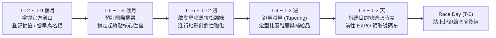

8
# 全球四季跑旅日曆：1 至 12 月年度世界絕景馬拉松規劃指南

海外跑旅（Running Travel）不僅是一場體能極限的挑戰，更是一次將跑步愛好與深度環球旅行完美融合的非凡體驗。然而，面對跨洲長途飛行、季節氣候轉換、各國賽事繁複的抽籤與報名窗口，跑者若能在年初建立系統化的「年度跑旅日程規劃」，便能有條不紊地安排課表週期、提早搶訂機酒住宿，並以巔峰狀態站在夢想賽道的起跑線上。

本篇日曆依據 12 個月份的時序排列，系統化收錄全球 12 場必跑絕景與經典馬拉松，為全球跑者提供清晰、實用的年度賽事規劃圖譜。

---

## 1. 全球 12 場馬拉松月份總覽矩陣

| 月份 | 賽事名稱 | 舉辦地點 | 賽事類型 | 氣候與賽道特色 | 建議報名啟動時間 |
| :---: | :--- | :--- | :--- | :--- | :--- |
| **3 月** | **[[日本東京馬拉松|東京馬拉松]]** | 日本・東京 | 世界大滿貫 / 都會競速 | 5°C–12°C，涼爽微風，極平坦雙重賽道，96%完賽率 | 前一年 8–9 月（抽籤） |
| **3 月** | **[[羅馬馬拉松|羅馬馬拉松]]** | 義大利・羅馬 | 歷史文化 / 古都巡禮 | 10°C–18°C，地中海早春，平坦但含 6km 鵝卵石路面 | 前一年 5–8 月（早鳥報名） |
| **4 月** | **[[倫敦馬拉松|倫敦馬拉松]]** | 英國・倫敦 | 世界大滿貫 / 慈善跑旅 | 8°C–15°C，泰晤士河沿岸平緩，全球最狂熱百萬應援 | 前一年 4–5 月（抽籤） |
| **4 月** | **[[美國大瑟爾國際馬拉松|美國大瑟爾國際馬拉松]]** | 美國・加州 1 號公路 | 自然絕景 / 海岸丘陵 | 6°C–14°C，太平洋懸崖海風與颶風角連續爬升 | 前一年 8–9 月（抽籤） |
| **6 月** | **[[南非五大野生動物馬拉松|南非五大野生動物馬拉松]]** | 南非・恩塔貝尼 | 極限冒險 / 野生動物生態 | 6°C–24°C，非洲冬季高原乾爽，無圍欄直面五霸巨獸 | 行程前 90 天（套裝名額） |
| **8 月** | **[[吳哥窟王朝馬拉松|吳哥帝國馬拉松]]** | 柬埔寨・暹粒 | 歷史文化 / 雨林神廟 | 28°C–34°C，高溫高濕熱帶氣候，穿越千柱古蹟神廟 | 每年 2–5 月（線上直接報名） |
| **9 月** | **[[少女峰馬拉松|瑞士少女峰馬拉松]]** | 瑞士・因特拉肯 | 自然絕景 / 高山越野 | 0°C–18°C，阿爾卑斯萬年冰河，爬升 1,953m 終極考驗 | 每年 2 月（通常數小時搶罄） |
| **9 月** | **[[約旦佩特沙漠馬拉松|約旦佩特拉沙漠馬拉松]]** | 約旦・佩特拉古城 | 極限冒險 / 荒漠戈壁 | 20°C–38°C，清晨古城蛇道，正午翻越高溫紅沙山脊 | 每年 1–4 月（套裝名額先到先得） |
| **9 月** | **[[德國柏林馬拉松|德國柏林馬拉松]]** | 德國・柏林 | 世界大滿貫 / 最速賽道 | 12°C–18°C，秋高氣爽，全球公認最易破紀錄 PB 賽道 | 前一年 9–11 月（抽籤/BQ） |
| **11 月** | **[[雅典經典馬拉松|雅典經典馬拉松]]** | 希臘・雅典 | 歷史經典 / 史詩朝聖 | 12°C–20°C，自馬拉松鎮至全大理石體育場，21km長爬升 | 每年 5–7 月（線上直接報名） |
| **11 月** | **[[紐西蘭皇后鎮馬拉松|紐西蘭皇后鎮馬拉松]]** | 紐西蘭・皇后鎮 | 自然絕景 / 湖光山色 | 8°C–18°C，南半球初夏高山湖泊，魔戒中土純淨絕景 | 每年 3–6 月（早鳥階段遞增） |
| **11 月** | **[[日本富士山|日本富士山馬拉松]]** | 日本・山梨縣河口湖 | 自然絕景 / 湖畔紅葉 | 2°C–12°C，深秋楓紅與雪頂富士山，含心碎坡挑戰 | 每年 5–8 月（先到先得額滿即止） |

---

## 2. 四季跑旅深度規劃與參賽策略

### 🌸 春季賽季（3月 – 4月）：都會競速與春意盎然的跑道
- **季節特色**：北半球冬末初春，氣溫介於 8°C 至 15°C 之間，是跑出個人最佳成績（PB）的黃金窗口。
- **賽事組合**：
  - **3 月上旬**：[[日本東京馬拉松|東京馬拉松]]（亞洲六大滿貫之首，全城熱情、櫻花初綻的殿堂賽事）。
  - **3 月中旬**：[[羅馬馬拉松|羅馬馬拉松]]（古羅馬兩千年歷史中心巡禮，免抽籤歐洲首選）。
  - **4 月下旬**：[[倫敦馬拉松|倫敦馬拉松]]（世界最大慈善募款盛會，泰晤士河沿岸極速狂飆）。
  - **4 月底**：[[美國大瑟爾國際馬拉松|美國大瑟爾國際馬拉松]]（沿加州 1 號公路馳騁，兼具 BQ 認證與太平洋絕景）。
- **備戰重點**：此階段賽事需在寒冷的冬季完成 12–16 週專項馬拉松課表，需格外重視低溫熱身與肌肉保暖。

### ☀️ 夏季賽季（6月 – 8月）：反向季節避暑與熱帶異域挑戰
- **季節特色**：北半球盛夏高溫酷暑，常規公路賽進入休賽期。跑者可轉戰南半球冬季，或前往熱帶展開以文化探索為主的耐力慢跑。
- **賽事組合**：
  - **6 月中旬**：[[南非五大野生動物馬拉松|南非五大野生動物馬拉松]]（正值南非冬季乾季，氣候涼爽宜人，奔跑於非洲大草原直面野生巨獸）。
  - **8 月上旬**：[[吳哥窟王朝馬拉松|吳哥帝國馬拉松]]（熱帶雨季中的世界文化遺產，高溫高濕考驗心志，以朝聖心態體驗心靈跑道）。
- **備戰重點**：南非賽事需著重越野路面適應與陡坡爬升肌力；吳哥窟賽事則需提前進行耐熱訓練並嚴格執行高頻率電解質補給。

### 🍁 秋季賽季（9月 – 11月）：全球跑旅的高峰爆發期
- **季節特色**：全年海外跑旅賽事最密集、景致最多元的頂級黃金賽季。
- **賽事組合**：
  - **9 月上旬**：[[少女峰馬拉松|瑞士少女峰馬拉松]]（登頂阿爾卑斯萬年冰河，累積爬升近兩千公尺的山岳之王）。
  - **9 月初**：[[約旦佩特沙漠馬拉松|約旦佩特拉沙漠馬拉松]]（穿越玫瑰紅古城，深入中東乾燥荒漠紅砂戈壁）。
  - **9 月下旬**：[[德國柏林馬拉松|德國柏林馬拉松]]（全球跑者爭相朝聖的世界紀錄誕生地，衝過布蘭登堡門的榮耀）。
  - **11 月上旬**：[[雅典經典馬拉松|雅典經典馬拉松]]（現代馬拉松起源史詩，直奔全大理石競技場）。
  - **11 月中旬**：[[紐西蘭皇后鎮馬拉松|紐西蘭皇后鎮馬拉松]]（飛往南半球初夏，環抱高山雪峰與純淨冰河湖泊）。
  - **11 月下旬**：[[日本富士山|日本富士山馬拉松]]（富士山初雪冠頂與深秋漫山紅葉相映成趣的極致景觀跑）。
- **備戰重點**：9 月初賽事需在盛夏維持高強度訓練；11 月賽事則享有完整的秋季涼爽訓練期，容易累積出扎實的長距離里程。

### ❄️ 冬季賽季（12月 – 2月）：體能休整、冬訓累積與名額抽籤期
- **規劃方向**：此期間主要以基礎有氧底耐力（Base Building）與力量訓練為主，並全面啟動下半年度世界大滿貫（柏林、倫敦、東京）與極限賽事的官方抽籤與報名登記作業。

---

## 3. 海外跑旅報名與前置作業時程倒數表（Lead-Time Timeline）

一場成功的海外馬拉松之旅，至少需提前 6 至 12 個月進行周密安排：

### 3.1 關鍵倒數檢核清單
1. **T-9 個月（資格與名額鎖定）**：
   - 確認各賽事公眾抽籤公佈日期；若未中籤，立即評估「官方慈善名額」或「國際官方旅行社套裝行程（ITO）」。
2. **T-6 個月（機酒與簽證申請）**：
   - 城市馬拉松（如東京、倫敦、柏林）起終點周邊飯店在賽日通常極快滿房或價格翻倍，務必儘早預訂具備免費取消條款的住宿。
   - 檢查護照效期是否在 6 個月以上，辦理申根簽證、美國 ESTA/B1B2、約旦簽證等。
3. **T-3 個月（賽道特性專項適應）**：
   - 若備戰**少女峰**或**雅典**：每週加入 1 次爬坡長距離跑（Hilly Long Run）或階梯機肌耐力訓練。
   - 若備戰**羅馬**：安排部分碎石或石板路段慢跑，強化足底小肌群與腳踝本體感覺。
   - 若備戰**大瑟爾**：加入抗逆風與上下坡離心收縮的下坡肌力訓練。
4. **T-1 週（長途飛行與行前整備）**：
   - 隨身行李（Carry-on）必須放置**比賽跑鞋、號碼布確認單、專用跑衣與常用能量膠**，切勿托運，以防行李延誤導致無法參賽。
   - 長途越洋飛行穿著漸進式壓縮小腿襪，並定時走動多補充水分，預防深層靜脈曲張與下肢水腫。

---

## 4. 相關賽事詳細指南導航
- 探索春季 3 月都會競速：[[日本東京馬拉松]] ｜ [[羅馬馬拉松]]
- 探索春季 4 月頂級挑戰：[[倫敦馬拉松]] ｜ [[美國大瑟爾國際馬拉松]]
- 探索夏季 6–8 月異域獵遊：[[南非五大野生動物馬拉松]] ｜ [[吳哥窟王朝馬拉松]]
- 探索秋季 9 月高山與殿堂：[[少女峰馬拉松]] ｜ [[約旦佩特沙漠馬拉松]] ｜ [[德國柏林馬拉松]]
- 探索秋末 11 月絕景朝聖：[[雅典經典馬拉松]] ｜ [[紐西蘭皇后鎮馬拉松]] ｜ [[日本富士山]]
